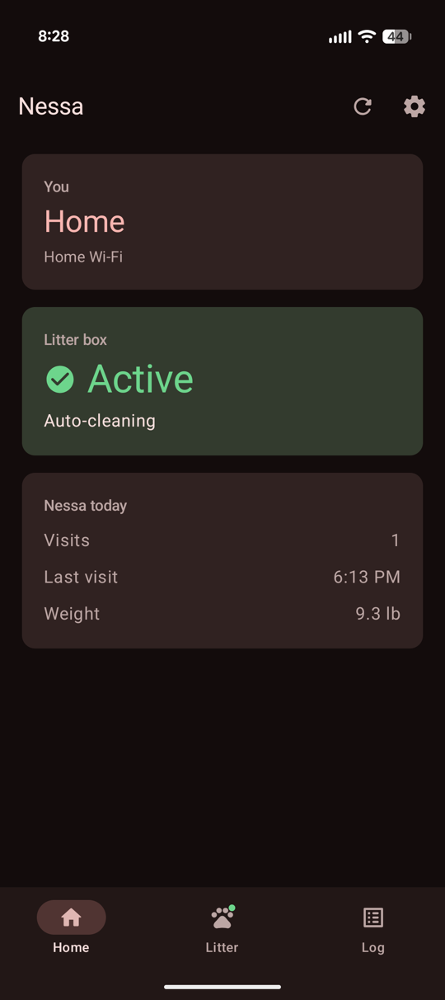
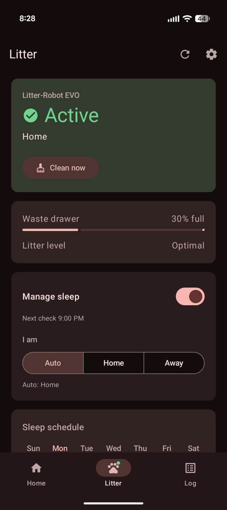
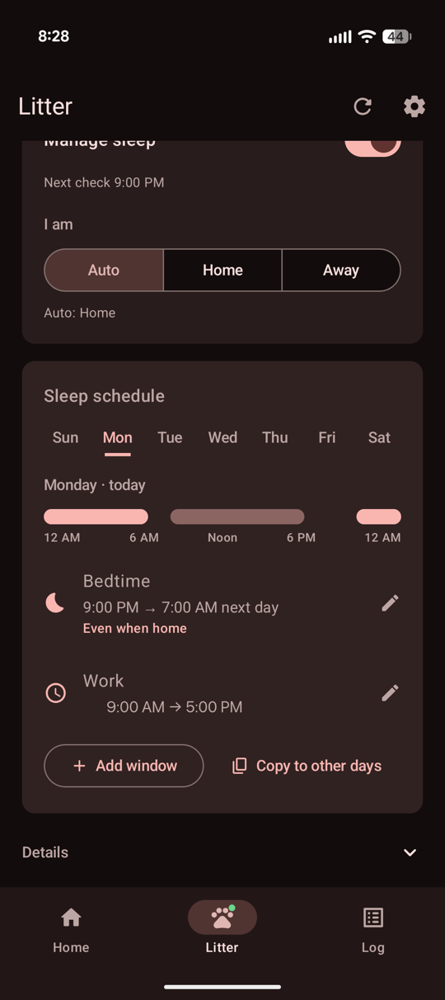
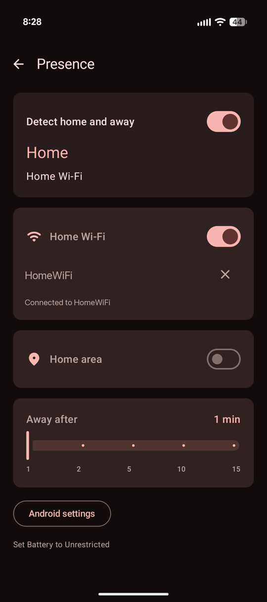
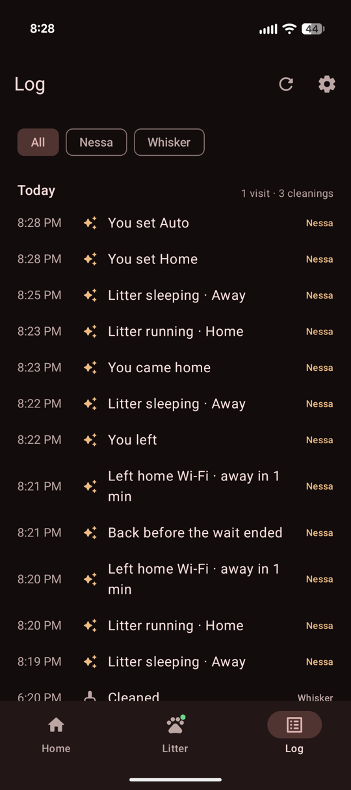

# Nessa

A personal Android app for Nessa the cat. It looks after her Litter-Robot EVO with the control
Whisker's own app doesn't give: the robot sleeps whenever nobody is home, and on a schedule with
as many sleep windows per day as you like.

Open source, no ads, no analytics, no Google Play Services. Not affiliated with Whisker.

<p align="center">
  
  &nbsp;
  
  &nbsp;
  
</p>
<p align="center">
  
  &nbsp;
  
</p>

## Why

A self-cleaning litter box turns its globe on its own. I don't want that happening while nobody is
home to notice if something goes wrong with the cat inside. Whisker's app can only do one sleep
window per day and knows nothing about whether anyone is home. Nessa fills that gap.

| | Whisker app | Nessa |
|---|---|---|
| Sleep windows per day | One | Any number, named (Bedtime, Work, Gym…) |
| Different windows on different days | Limited | Every day has its own list |
| Sleeps when you leave home | No | Yes, from home Wi-Fi and an optional home area |
| Wakes when you come back | No | Yes, within seconds |
| Shows why it is asleep | No | "Sleeping · Bedtime", "Sleeping · Away" |
| A log of what the app itself did | No | Yes, next to the robot's own history |

Sleep, not power-off: while the robot sleeps it doesn't clean, but it still records visits and
weight.

## What it does

**Home**: whether you're home, what the litter box is doing, and Nessa's visits and weight today.

**Litter**
- Status in one word with its own color: Active (green), Sleeping (indigo), Off or Offline (grey),
  needs attention (amber). Waste drawer and litter levels. Clean now.
- **Manage sleep**: a master switch. While it's on, Nessa writes the robot's sleep schedule. Turning
  it off puts back the schedule the robot had before.
- **I am**: Auto follows presence detection. Home and Away overrule it by hand.
- **Sleep schedule**: pick a day, then add, edit, delete or copy its windows. Each window has a
  name, a start and end (it may run past midnight), and an "Even when home" switch.

**Log**: one timeline of what Nessa did ("You left", "Litter sleeping · Away") and what the robot
recorded (visits with length and weight, cleanings), tagged Nessa or Whisker, with filters.

**Settings**
- **Presence**: home Wi-Fi names, an optional home area with a radius, and how long to wait before
  counting you as away (1, 2, 5, 10 or 15 minutes). A live countdown shows while the wait runs.
- **Connections**: sign in to Whisker, test the connection, pick a robot if the account has several.

## The rule

Presence comes first. The schedule is the fallback, and also carries quiet time.

| Situation | Robot |
|---|---|
| You're away | Sleeps |
| You're home, inside a window marked "Even when home" (Bedtime) | Sleeps |
| You're home, inside any other window (Work, Gym) | Active: being home wins |
| You're home, outside every window | Active |
| Presence is off or can't tell | The schedule alone decides |

## How it works

- **The robot stores one sleep entry per day.** Nessa rewrites that schedule at every change: a
  window starting or ending, you leaving or coming home, midnight. Quiet windows are also written for
  the other days, so nights are still covered if the phone is off.
- **Every write is checked.** Nessa saves the schedule the robot had, writes the new one, then reads
  the robot back until it agrees, and says so in the log if it doesn't.
- **Presence is event-driven.** Android tells Nessa when the Wi-Fi changes; nothing polls. The away
  wait is a system alarm, so it fires with the phone asleep. A quiet ongoing notification keeps the
  watcher alive.
- **Whisker has no public API.** Nessa talks to the same servers as Whisker's app, following the
  open-source [pylitterbot](https://github.com/natekspencer/pylitterbot) library. If Whisker changes
  something, Nessa can break until it is updated. All of that code is in `whisker/`.

## Limits

- Tested with one Litter-Robot EVO on a Pixel 9. Other Whisker robots are not supported.
- Days with several windows need the phone on and online at each change. Bedtime does not.
- If the phone dies while you're home, daytime windows on later days are not applied.
- "Power off" as an alternative to sleep is not built yet.
- Whisker does not record every visit, and some weights are off, so visit numbers are a floor.

## Privacy

- Your Whisker sign-in is stored encrypted on the phone (Android Keystore) and sent only to Whisker.
- Home Wi-Fi names and the home location stay in the app's private storage. They are never logged
  or sent anywhere.

## Build and install

Needs a JDK (17 or newer) and the Android SDK. Android 12 or newer on the phone.

```sh
./gradlew testDebugUnitTest      # unit tests
./gradlew assembleDebug
adb install -r app/build/outputs/apk/debug/app-debug.apk
```

Then open Nessa, connect your Whisker account, and turn on **Manage sleep** on the Litter tab. For
presence, open Settings → Presence, allow location "all the time" (Android requires it to read the
Wi-Fi name), add your home Wi-Fi while connected to it, and set Battery to Unrestricted.

## More

- `docs/DESIGN.md`: the design, including what was verified on the real robot.
- `docs/plans/`: build plans.

## License

MIT
